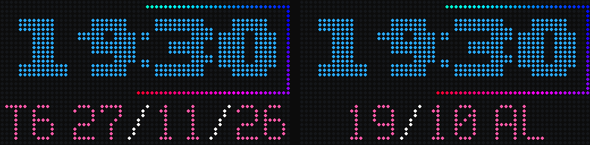

# Đồng hồ P5 — ESP32-S3, panel HUB75 64×32

Nhánh `feature/p5-clock` chuyển ứng dụng sang đồng hồ Việt Nam (UTC+7).



- Chỉ hai hàng: giờ/phút 24 giờ cao **13 px**, lịch bitmap cao **8 px** (nét gốc, không kéo giãn).
- Viền giây rainbow cao 1 pixel quanh vùng giờ: bắt đầu giữa cạnh trên, chạy theo chiều kim đồng hồ, đầy một vòng ở giây 59 rồi bắt đầu lại khi sang phút.
- Dấu hai chấm bật/tắt theo từng giây; màu giờ thay đổi mỗi giờ, màu lịch thay đổi mỗi ngày tại UTC+7. Dấu `/` luôn màu trắng để dễ phân biệt với chữ lịch.
- Hàng lịch luân phiên mỗi **6 giây**: `T6 27/11/26` và `19/10 AL` (thêm `N` nếu tháng nhuận).
- Khi đổi lịch, dòng mới trượt lên trong **400 ms**; giờ luôn đứng yên. Có thể chỉnh trong `main/config/app_config.h`.
- Âm lịch tính tại máy theo UTC+7, có tháng nhuận; không phụ thuộc API lịch.
- Sau đồng bộ NTP thành công, tắt Wi-Fi hoàn toàn 24 giờ. Tác vụ chờ giữa các lần cập nhật; DMA tiếp tục quét LED. Độ sáng mặc định 48/255.

## Cấu hình Wi-Fi

1. Lần đầu, kết nối mạng **P5-CLOCK-xxxx** (không mật khẩu).
2. Mở **http://192.168.4.1**: trang tự quét Wi-Fi **2.4 GHz**, chọn mạng rồi nhập mật khẩu. Có nút **Quét lại Wi-Fi**, mức sóng và ô nhập thủ công cho mạng ẩn.
3. Mạch thử kết nối và lấy giờ trong 60 giây. Chỉ lưu Wi-Fi vào NVS sau khi lấy giờ thành công; sau đó AP và Wi-Fi tắt.
4. Sai mật khẩu / mất Internet: AP vẫn mở để nhập lại. Cấu hình đã lưu trước đó được giữ nguyên.
5. Giữ **BOOT (GPIO0) 2 giây** để mở lại AP. Nếu đồng hồ đã có giờ và Wi-Fi đã lưu, AP tự đóng sau 5 phút không thử kết nối.

Khởi động lại sẽ tự dùng Wi-Fi đã lưu để lấy giờ. Nếu đồng bộ hàng ngày thất bại, đồng hồ tiếp tục chạy bằng giờ hệ thống và thử lại sau 1 giờ. Khi chưa có cấu hình Wi-Fi và chưa lấy được giờ, màn hình chỉ hiện `SETTING`; đã lưu Wi-Fi hoặc đang thử kết nối thì hiện `CONNECTING`, không hiện IP. Mất nguồn hoàn toàn cần lấy giờ lại qua Internet; chưa có RTC pin dự phòng.

Không dùng deep sleep/light sleep khi hiển thị liên tục: các chế độ này dừng ngoại vi quét HUB75. Điện tiêu thụ thực tế và sai số giờ trong 24 giờ cần đo trên mạch; panel LED thường là phần tiêu thụ chính.

## Phần cứng và build

Đã giữ nguyên chân panel trong `main/config/app_config.h` theo cấu hình ESP32-S3 đang có trên máy:

| HUB75 | R1 | G1 | B1 | R2 | G2 | B2 | A | B | C | D | E | LAT | OE | CLK |
|---|---|---|---|---|---|---|---|---|---|---|---|---|---|---|
| GPIO | 10 | 11 | 12 | 16 | 17 | 18 | 35 | 36 | 37 | 38 | -1 | 5 | 6 | 4 |

Panel 64×32 scan 1/16, driver FM6126A. Dùng nguồn 5V phù hợp và nối chung GND.
ESP-IDF **5.5.4**, target **esp32s3**, flash **2MB**.

```sh
git clone --recursive -b feature/p5-clock https://github.com/Hoangminhfcb/esp32-p5-clock.git
cd esp32-p5-clock
idf.py set-target esp32s3
idf.py build
idf.py -p COMx flash monitor
```

Không cần sửa `secrets.h`: firmware đồng hồ dùng cấu hình Wi-Fi qua web.
Thư viện HUB75 được khóa bằng submodule; chạy `git submodule update --init --recursive` nếu clone thiếu.

## Kiểm tra trên máy (GCC C++17)

```sh
g++ -std=c++17 -Wall -Wextra -Werror -I main tools/test_lunar.cpp main/app/lunar.cpp -o build/test_lunar.exe
./build/test_lunar.exe
g++ -std=c++17 -Wall -Wextra -Werror -I main tools/test_clock_layout.cpp main/gfx/clock_face.cpp main/gfx/color.cpp -o build/test_clock_layout.exe
./build/test_clock_layout.exe
```

Các mốc kiểm tra gồm Tết 2024–2027, tháng 2 nhuận 2023, chuyển năm; kiểm tra miền giá trị và tính liên tiếp của 36.525 ngày trong 2000–2099 và giới hạn pixel cho mọi giờ/phút và ngày/tháng. Đây không phải đối chiếu toàn bộ lịch thiên văn trong 100 năm.

Mã ứng dụng bảng chữ/ghép màn hình cũ vẫn được giữ làm tham khảo nhưng không được biên dịch trong nhánh đồng hồ. Tài liệu cũ trong `docs/` mô tả ứng dụng bảng chữ.

## Font đồng hồ

Số giờ dùng [Silkscreen Bold](https://github.com/googlefonts/silkscreen) của Jason Kottke (SIL OFL 1.1), raster đúng ô pixel 13×13 để chừa khoảng trống cho viền giây; lịch dùng Spleen 6x12, phần nét cao 8 px. Không dùng số bảy đoạn hay kéo bitmap 3x5. Bitmap đã sinh được commit nên build ESP-IDF không cần Pillow.

Sinh lại bằng `python tools/gen_clock_font.py` (cần Pillow). Giấy phép: `tools/gen_fonts/font_src/LICENSE-Silkscreen.txt`, `tools/gen_fonts/font_src/LICENSE-Spleen.txt`.

API cấu hình: `GET /scan?refresh=1` yêu cầu quét; `GET /scan` trả `scanning` và danh sách `{ssid,rssi,secured}`. Quét thực hiện trong tác vụ mạng; màn hình vẫn cập nhật độc lập. Chặn quét khi đang thử kết nối để tránh xung đột driver.

Kiểm tra luồng chọn Wi-Fi: `node tools/test_clock_portal.cjs` (Node.js, không cần cài dependency).

## Phối màu tùy chọn

Giữ BOOT 2 giây, vào Wi-Fi cấu hình và mở **Phối màu đồng hồ và lịch**. Mỗi bộ có 4 màu gốc tùy chọn. Bấm **Lưu bảng màu** để lưu riêng vào NVS (không cần nhập lại mật khẩu Wi-Fi). Giờ nội suy 24 màu cho 24 giờ; lịch nội suy 28 màu và đổi theo ngày dân sự Việt Nam. Bảng màu được giữ sau khi mất điện. Dấu `/` vẫn trắng; vạch giây luôn rainbow.

API bảng màu: `GET /palette` và `POST /palette` với `{"time":["#RRGGBB",...],"date":["#RRGGBB",...]}`; mỗi mảng đúng 4 màu.
