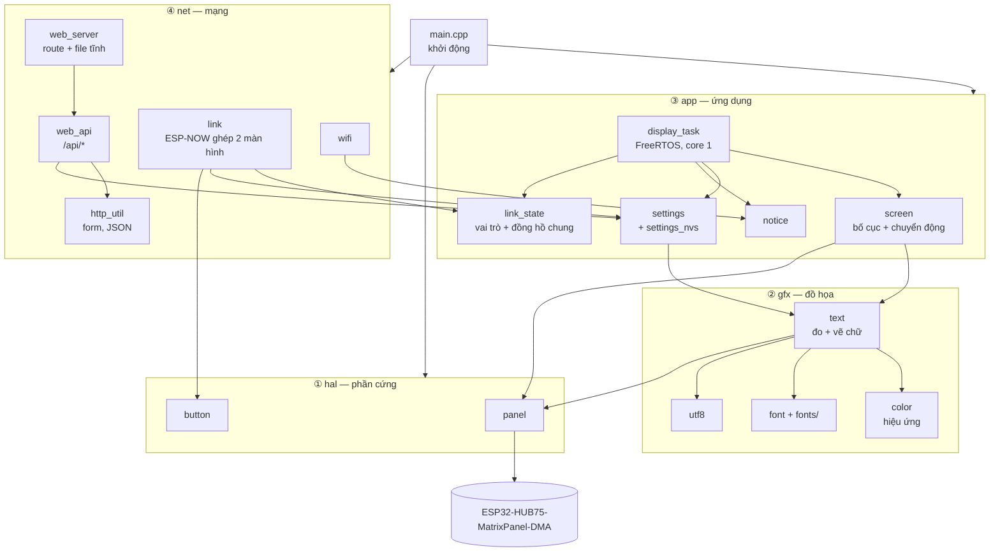
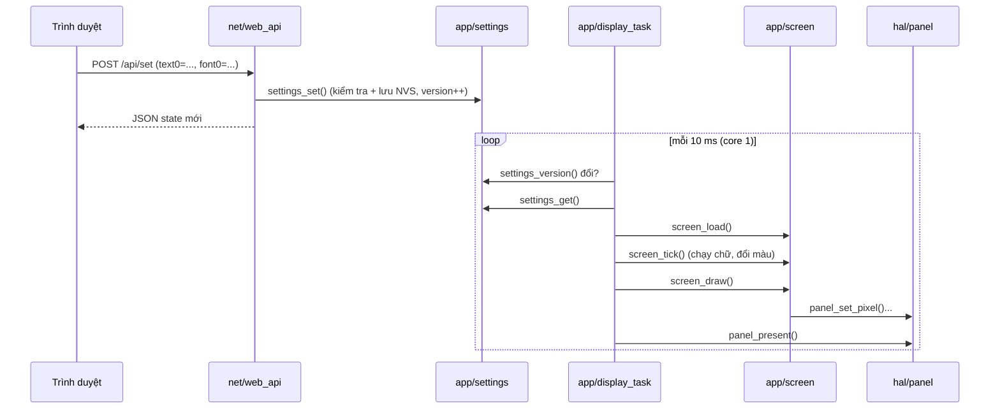

# Kiến trúc

## Các lớp

Code trong `main/` chia làm 4 lớp và 1 thư mục cấu hình. **Lớp trên gọi lớp dưới, không gọi ngược lên.**
Nhờ vậy, sửa một lớp ít ảnh hưởng tới lớp khác.



`config/app_config.h` là hằng số dùng chung, lớp nào cũng được include.

| Lớp | Thư mục | Trách nhiệm | Không được |
|---|---|---|---|
| ① hal | `hal/` | Nói chuyện với phần cứng (panel HUB75) | Biết gì về chữ, cài đặt, web |
| ② gfx | `gfx/` | Font, UTF-8, màu, đo & vẽ chữ. Chỉ gọi `panel_set_pixel` | Dùng FreeRTOS, NVS, WiFi |
| ③ app | `app/` | Cài đặt, thông báo, bố cục, task vẽ | Gọi HTTP / WiFi |
| ④ net | `net/` | WiFi, HTTP server, API JSON, giao diện web | Vẽ trực tiếp lên panel |

## Luồng dữ liệu



- **Đồng bộ giữa các task**: `settings` và `notice` dùng mutex. Task vẽ chỉ đọc *bản sao* cài đặt, không giữ khóa khi vẽ.
- **Phát hiện thay đổi**: `settings_version()` / `notice_version()` tăng mỗi lần đổi. Task vẽ so sánh với giá trị đã thấy lần trước.
- **Double buffer**: vẽ vào buffer phụ, rồi `panel_present()` đổi buffer → không chớp.

## Task & core

| Task | Core | Ưu tiên | Ghi chú |
|---|---|---|---|
| WiFi / lwIP (ESP-IDF) | 0 | hệ thống | |
| `httpd` (web server) | 0 | mặc định | stack 6 KB |
| `display` | 1 | 5 | vẽ tối đa 100 khung/giây; chỉ vẽ khi có thay đổi |
| `link` | 0 | 4 | ESP-NOW ghép 2 màn hình + nút BOOT, chu kỳ 50 ms |

## Ghép 2 màn hình

Xem [pairing.md](pairing.md). Tóm tắt: `app/link_state` giữ vai trò (riêng/master/slave), màn hình ảo (`link_canvas_width()`, `link_view_x()`) và đồng hồ chung `link_now_ms()`. `net/link` lo truyền ESP-NOW. `display_task` lấy nội dung từ `settings` (riêng/master) hoặc `link_remote_get()` (slave), rồi `screen` vẽ đúng phần của panel mình.

## Font & tiếng Việt

- Có 2 **kiểu chữ** (`FontFamily`): **Đậm** và **Mỏng** (nét 1 px ở mọi cỡ). Mỗi kiểu được render sẵn ở **mọi cỡ** từ 6 đến 17 px.
  - **Cỡ chữ** là chiều cao chữ IN HOA. Vì mỗi cỡ là một bitmap riêng, tăng/giảm đúng 1 px mà chữ vẫn sắc nét.
  - `font_get(kiểu, cỡ)` trả về bitmap cần dùng.
- Bitmap: mỗi cột chữ là 1 `uint32_t` (bit0 = hàng trên), nên chữ cao tối đa 32 px.
- Ký tự gồm ASCII `0x20..0x7E` và 134 chữ tiếng Việt (`FONT_EXT_CODES`, tìm nhị phân).
- Chuỗi lưu dạng **UTF-8**. `gfx/utf8` giải mã từng ký tự. Web gửi chữ ở dạng dựng sẵn (NFC).
- `text_measure()` trả về chiều cao *thực tế* của chuỗi:
  - Chữ không dấu dùng khung ASCII cố định, nên dòng chữ không nhảy lên xuống.
  - Chữ có dấu thì cao thêm phần dấu.
- Dữ liệu font **sinh tự động** bằng `tools/gen_fonts` (render DejaVu không khử răng cưa).
  - Cỡ nhỏ (< 12): dấu tiếng Việt được ghép bằng mẫu pixel cho rõ.
  - Cỡ lớn: dùng dấu có sẵn của font.

## Cài đặt (`DisplaySettings`)

```
DisplaySettings
├── lines        1..2
├── brightness   0..255
├── fx_speed     1..10
└── line[2]: LineSettings
    ├── text      UTF-8, ≤ 255 byte
    ├── font      id kiểu chữ (0 Đậm · 1 Mỏng)
    ├── size      cỡ chữ = chiều cao chữ in hoa (px)
    ├── align     0 trái · 1 giữa · 2 phải
    ├── effect    0 một màu · 1 cầu vồng · 2 đổi màu
    ├── color     0xRRGGBB
    └── speed_ms  10..500
```

- Cài đặt được lưu thành 1 blob NVS (`namespace "display"`, key `"cfg"`).
- **Đổi cấu trúc struct thì phải tăng `CFG_MAGIC`** trong `app/settings_nvs.cpp`, để không đọc nhầm dữ liệu cũ.
- `settings_sanitize()` ép mọi giá trị về khoảng hợp lệ. Nếu tổng chiều cao các hàng quá 32 px, nó tự giảm cỡ chữ hàng cao nhất, mỗi lần 1 px.
